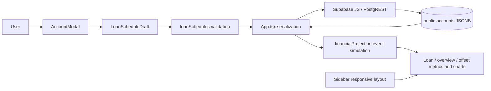

# UnDebt — Proposed dev technical design

**Branch:** `dev` · **Status:** Proposed implementation; not production until merged to `main`.
**Audience:** Technical architects, designers, and developers.
**Production baseline:** [As-is technical design](./production.md). This page describes the full current proposal, including its limitations; code state is authoritative.

## 1. Solution summary and architecture

The dev feature extends the loan form and local simulator from one recurring loan payment to a sequence of dated payment/rate windows. It preserves Expo/React Native, Supabase Auth/Postgres, the `accounts` table, its ownership/RLS model, and existing chart/summary contracts. No schema migration is proposed: typed schedule data is serialized into the existing `payments` and `interest_rates` JSONB arrays.



### Responsibilities

| Layer/module | Proposed responsibility |
|---|---|
| `components/AccountModal.tsx` | Build/edit repayment draft; expose staged, interest-only, card, and BNPL controls; show validation errors |
| `lib/loanSchedules.ts` | Draft/repayment types, UTC date utilities, defaults, date/overlap/coverage validation |
| `App.tsx` | Convert form draft to persisted JSONB arrays; keep existing account create/update flow |
| `lib/financialProjection.ts` | Parse legacy and new entries, generate payment events, accrue interest, simulate offsets and annual series |
| `lib/paymentEntries.ts` | Preserve activity recurrence, historical balances, Save/Spend flow aggregation |
| `components/Sidebar.tsx` | Use a scrollable vertical navigation/sidebar at compact widths instead of horizontal compact navigation |
| Supabase | Remains auth + row storage; calculation remains client-only |

**Flow:** Edit opens → app passes the selected account → modal restores legacy/new payment and rate entries into a draft → user edits → validation rejects invalid/overlapping/out-of-term/incomplete schedules → `App.tsx` replaces only schedule entry types, preserves other activities, builds rate windows, and inserts/updates the account row → fetch accounts → recompute projections and UI.

## 2. UI and behavior

- **Loan forms:** one or more repayment windows with amount, payment type, frequency, start/end, and optional override rate; add/remove schedule controls for eligible loan types.
- **Interest-only:** optional dated period; a repayment event with no amount is intended to pay accumulated interest.
- **Credit card:** minimum/full choice, monthly cadence, and optional 0% period with normal-rate windows before/after it.
- **Buy Now Pay Later:** default fortnightly repayment; UI limits choices to weekly, fortnightly, monthly, and quarterly.
- **Responsive navigation:** compact layout becomes a vertical, scrollable sidebar; navigation labels/icons remain selectable.
- Existing Overview, Loans, Accounts, offset management, Save, Spend, Help, Settings, chart periods/series, and account CRUD remain in scope and retain existing component contracts.

## 3. Data structures and persistence contract

`LoanScheduleDraft` is form state, not a database entity:

```ts
interface RepaymentScheduleDraft {
  id: string;                  // transient UI key
  amount: string;              // editable text
  type: 'Principal and Interest' | 'Interest Only' | 'Min balance' | 'Full payment';
  frequency: string;
  startDate: string;           // YYYY-MM-DD
  endDate: string;
  sameInterestRate: boolean;
  interestRate: string;        // optional rate override text
}

interface LoanScheduleDraft {
  interestOnlyPeriodEnabled: boolean;
  interestOnlyStartDate: string;
  interestOnlyEndDate: string;
  interestFreePeriodEnabled: boolean;
  interestFreeStartDate: string;
  interestFreeEndDate: string;
  creditCardPaymentType: 'Min balance' | 'Full payment';
  repayments: RepaymentScheduleDraft[];
}
```

### Stored payload

```json
{
  "payments": [
    {
      "type": "Principal and Interest",
      "periodKind": "repayment",
      "amount": 850,
      "frequency": "Monthly",
      "startDate": "2027-01-15",
      "endDate": "2056-12-15",
      "sameInterestRate": false,
      "interestRate": 6.1
    }
  ],
  "interest_rates": [
    { "rate": 6.1, "date": "2027-01-15", "endDate": "2056-12-15", "periodKind": "repayment" }
  ]
}
```

Other stored schedule entries represent interest-only periods in `payments`; credit-card interest-free windows are `interest_rates` entries with `rate: 0` and `periodKind: "interest-free"`. A separate interest-rate entry restores the normal rate after the promotional end. Transient draft IDs are not persisted as account or schedule keys. Existing income, savings transfers, part-payments, bills, and expenses remain in `payments`.

The relational model, enums, RLS, triggers, and indexes are unchanged from [production schema/setup](./production.md#3-persistence-model-and-schema). The same Supabase table writes and SQL diagnostics apply; there is no dev-only migration. Do not apply a schema change for this proposal unless the data-model decision changes.

## 4. Validation and date semantics

`validateLoanScheduleDraft()` currently:

1. Requires valid ISO loan dates; requires a maturity date for non-credit-card loans.
2. Requires at least one repayment draft. Non-card schedules require a positive repayment amount; all schedules require a frequency. A custom rate must be finite and non-negative.
3. Checks interest-only/free date ranges, schedule date order, loan-term bounds, and pairwise non-overlap across repayment and promotional periods.
4. For a loan with an end date, requires continuous coverage from `max(loan start, today)` through maturity by repayment or interest-only/free periods.

Date utilities parse dates as UTC calendar dates, reject impossible dates, add calendar days, and clamp month additions to a valid day. `financialProjection.getNextPayment()` generates the first due date one full configured frequency after the schedule start, then repeats from that start anchor. This convention must be confirmed with product/lender requirements.

## 5. Calculation model

The dev simulator still produces local estimates, not lender-grade statements. It parses valid saved payment/rate arrays, adds monthly interest boundaries, and splits each interval at the next generated repayment event. For each interest interval it selects a rate and computes a prorated period rate:

```text
periodRate = Σ ((annualRate_i / 100 / 12) × (segmentDuration_i / monthDuration))
```

where `annualRate_i` is the annual rate for segment `i`; `monthDuration` is the duration of the containing monthly interval.

```text
interest = max(0, balance - offsetBalance) × periodRate + chargeInterest
```

The offset is capped at loan balance; charge interest is prorated from charge date to interval end. Interest is added before a due payment. Additional part-payments are applied after scheduled payment events, only in the offset-enabled/actual simulation.

| Payment type | Current dev simulation |
|---|---|
| `Full payment` | Pays the entire simulated balance at each generated due date |
| `Interest Only`, no amount | Pays accumulated interest since the last payment, capped by balance |
| `Interest Only`, with amount | Pays the configured amount |
| Principal and Interest | Pays configured amount; no amortization amount is solved from rate/term |
| `Min balance` | Currently falls through to configured amount or zero; no minimum-balance formula is implemented |

The summary converts each configured payment to an annual amount using the frequency multiplier and divides by 12. It does not time-weight amounts by active schedule duration. Account/transaction interest, offsets, Save/Spend formulas, annual sampling, and 30-year horizon are described in [production calculation behavior](./production.md#5-calculation-behavior), except loan payment scheduling is now event-based.

## 6. Database and data interactions

Writes still target `public.accounts` using the signed-in Supabase client:

- Account insert/update writes `balance`, dates, account type, schedule-bearing `payments`, and `interest_rates`.
- Schedule editing filters out the recognized prior loan schedule entries, writes the draft’s repayment/interest-only entries, and retains non-schedule activity entries.
- Card promotional periods are represented as rate windows; non-card repayment-rate overrides become dated rate entries.
- RLS continues to enforce account-row ownership. JSONB schema validation is client-only, and replacing the JSON array is a read-modify-write operation; concurrent edits can overwrite each other.

The account-level schedule must remain backward compatible with production’s single-payment payload. The simulator accepts object/array parsing and aliases `startDate`/`date` and `endDate`/`end_date`; malformed JSON is treated as absent and may fall back to default rates. Local Supabase setup, core DDL, CRUD SQL equivalents, and schema/policy/trigger inspection queries are in the [production setup reference](./production.md#4-database-setup-and-query-reference); this dev proposal introduces no additional SQL.

## 7. Gaps and release gates

**Known implementation gaps to close or consciously accept:**

1. `Min balance` has no formula; with no entered amount its current simulated payment is zero. This is a release blocker unless implemented or explicitly scoped out.
2. `Principal and Interest` uses a user-entered amount; the system does not solve a payment from principal, rate, term, and compounding convention. The full-payment behavior is also a simplifying assumption.
3. Rate entries store `endDate`, but rate selection is driven by the latest start date and does not itself enforce the end date. Validate contiguous/non-overlapping rate windows and define rate behavior in gaps.
4. Rate/day-count/compounding conventions, payment date semantics, card statement/minimum rules, BNPL fees, and negative balances need product/lender specifications and golden calculation cases.
5. Test legacy rows and migration-less persistence; add focused unit tests for invalid/leap dates, overlaps, coverage gaps, month ends, schedule ordering, interest-rate boundaries, payment events, and expected balances/interest.
6. Check schedule restoration/replacement, card promotional end dates, empty optional values, errors, accessibility, and sidebar behavior at narrow widths. Add automated app typecheck/build and tests to CI; the Pages job is not an app build.
7. `SUPABASE_CONFIG` still points to a single hosted project; there is no staging/production environment selection. Do not validate dev changes against production user data. Add a dedicated staging Supabase project/configuration before shared-user testing.
8. Recheck deployed RLS and trigger behavior independently; this proposal makes no change to them.

**Acceptance before merge:** product sign-off on repayment semantics; calculation tests pass; old account rows still load/edit; no accidental loss of activity JSON; responsive/accessibility review complete; production documentation updated for exactly the merged behavior.

## 8. Dev → production lifecycle

1. `dev` is the proposed integration branch; `main` is production. For every material app change on `dev`, update `docs/dev.md` and `docs/dev.html` in the same commit. The workflow enforces both files on app changes.
2. Validate with `cd expoapp && npx tsc --noEmit`, focused tests, app/web checks, and authenticated RLS-backed create/edit/delete scenarios. Document failures and remaining gaps.
3. Open a reviewed `dev` → `main` PR. Update `docs/production.md` and `docs/production.html` to represent the exact release; the workflow enforces both when app files change in the PR.
4. Merge only after approval and accepted release gates. The merge updates production code and its documentation together. A merge does not apply Supabase migrations or deploy a native app binary.
5. GitHub Pages serves static design docs from `dev/docs`; at this revision the repository Pages source is branch `dev`, path `/docs`, and the Actions workflow also validates docs and publishes on dev pushes. It is not the Expo app. App distribution and database migration apply remain separate release operations.

**Code references:** [AccountModal.tsx](../expoapp/components/AccountModal.tsx) · [loanSchedules.ts](../expoapp/lib/loanSchedules.ts) · [App.tsx](../expoapp/App.tsx) · [financialProjection.ts](../expoapp/lib/financialProjection.ts) · [Pages workflow](../.github/workflows/docs-pages.yml).
