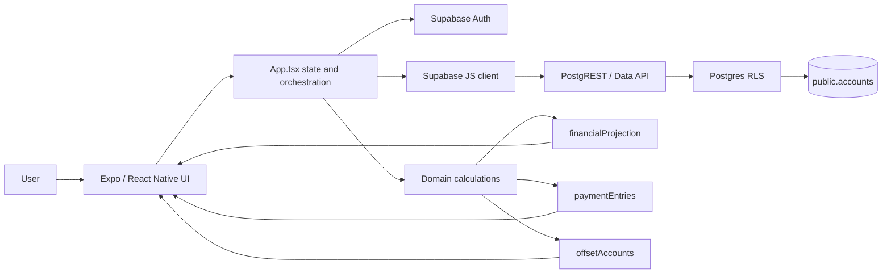
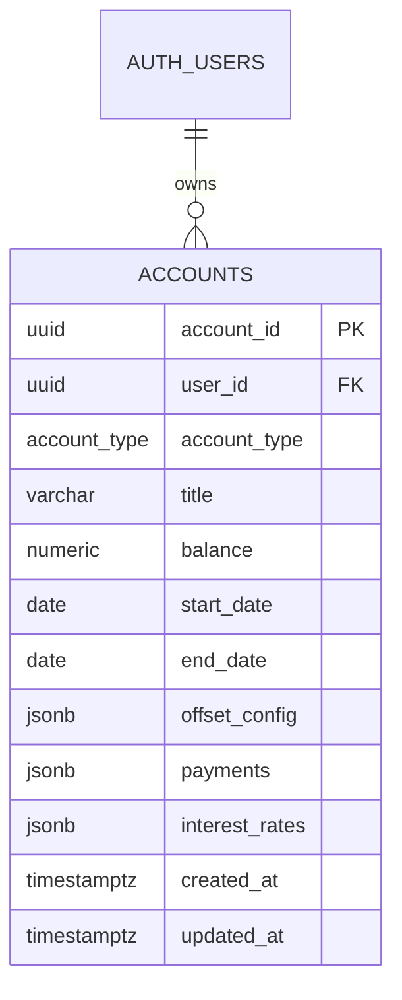

# UnDebt — Production technical design

**Branch:** `main` · **Baseline commit:** `60512dc` · **Status:** As implemented on production, not a target-state design.
**Audience:** Technical architects, designers, and developers.
**Proposed delta:** [Dev design](./dev.md). This production snapshot intentionally excludes dev-only multi-stage loan scheduling.

## 1. System overview

UnDebt is a client-rendered household finance planner. Expo/React Native screens collect account and cash-flow assumptions. TypeScript domain modules calculate current balances, forecasts, and summaries in the device/browser. Supabase provides email/password authentication, Postgres persistence, and row-level access control through its Data API. There is no application API server, scheduled backend worker, bank aggregator, or server-side projection engine.



### Runtime and component boundaries

| Layer | Responsibility | Main modules |
|---|---|---|
| Presentation | Navigation, forms, charts, responsive layout | `App.tsx`, `screens/`, `components/`, `theme/` |
| Orchestration | Auth session, selected tab, account collection, modal actions, Supabase reads/writes | `App.tsx`, `lib/supabase.ts` |
| Domain | Frequency expansion, account balance reconstruction, loan/asset projection, offset linking | `lib/paymentEntries.ts`, `lib/financialProjection.ts`, `lib/offsetAccounts.ts`, `lib/accountDisplay.ts` |
| Configuration | Account types, default rates/terms, financial-year rules | `config/accountTypes.ts`, `config.ts` |
| Platform services | Auth, Postgres, PostgREST, RLS | Supabase project; local CLI config at `supabase/config.toml` |

**Runtime versions:** Expo `~58.0.23`, React `19.3.0`, React Native `0.88.1`, TypeScript `~6.0.3`, Supabase JS `^2.119.0`, React Native Web `^0.21.4`. `expo-sqlite` is a dependency but is not used by the current application data path. `npm run web` starts Expo web; it does not build the static GitHub Pages app.

### Request and state flow

1. `supabase.auth.getSession()` initializes `user`; `onAuthStateChange()` tracks sign-in/out. `AuthScreen` uses Supabase email/password sign-up and sign-in.
2. When signed in, `fetchAccounts()` issues `.from('accounts').select('*').order('created_at', { ascending: false })`. The client does not add a `user_id` filter; RLS is expected to scope the result.
3. `App.tsx` stores the returned rows in React state, derives loan/transaction subsets, and memoizes summaries/projections. Domain calculation is local; it does not write forecast results.
4. Account create/update sends title, account type, balance, dates, `offset_config`, `payments`, and `interest_rates`. Activity actions replace the relevant JSONB array. Delete filters by `account_id`. Successful writes are followed by a refetch.
5. A new linked transfer is stored once on its source account and mirrored in calculations. Moving an existing activity between accounts performs two independent updates and attempts a compensating rollback if the second update fails; this edit is not an atomic database transaction.

## 2. UI and product surface

| Area | As-is capability |
|---|---|
| Overview | Total debt, assets, net worth, combined forecast |
| Loans | Loan table, create/edit/delete, balance forecast, scheduled/actual series, interest and repayment metrics |
| Accounts | Savings/checking/investment/transaction accounts, interest display, forecast, create/edit/delete |
| Loan management | Link cash/offset accounts to loans; set full, partial, or capped offset; add/edit/delete additional payments; show estimated savings |
| Save | Income and transfers-to-savings activities, period summary, comparison chart |
| Spend | Bill payments and expenses, available cash and projected remaining balance |
| Help & guides | In-app help |
| Settings/profile | Currency text field, financial-year start month, auth profile actions |

Account types: `HomeLoan`, `CreditCard`, `PersonalLoan`, `BuyNowPayLater`, `CarLoan`, `Savings`, `Checking`, `Investment`, `TransactionAccount`. The first five are loan types. Current currency display is `$`/AUD-oriented; the currency setting is not a general currency-conversion engine. Financial-year start defaults to July (zero-based month `6`).

## 3. Persistence model and schema

### Entity relationship



`expoapp/supabase/migrations/20261108135811_remote_schema.sql` is the authoritative migration. It creates a single application table; it does not create normalized transaction, repayment, or profile tables.

| Column | Definition / contract |
|---|---|
| `account_id` | UUID primary key, `gen_random_uuid()` default |
| `user_id` | UUID, `auth.uid()` default, FK to `auth.users(id)` |
| `account_type` | Required `public.account_type` enum |
| `title` | Nullable `varchar(255)` |
| `balance` | Required `numeric(15,2)`; no database default |
| `start_date` | Required `date`, defaults to `CURRENT_DATE` |
| `end_date` | Nullable `date` |
| `offset_config` | Nullable JSONB; default `{"percentage":null,"offset_type":"No Offset","linked_accounts":[]}` |
| `payments` | Nullable JSONB; default `[]` |
| `interest_rates` | Nullable JSONB; default `[]` |
| `created_at`, `updated_at` | Required `timestamptz`, default `now()` |

The enum `account_type` values are the nine account types above. Migration also creates `offset_type` with `Full Offset`, `Reduced Interest Rate`, `Capped Percentage Balance`, and `No Offset`; this enum is not the JSONB column type. Indexes: B-tree on account type and user ID; GIN on `payments` and `interest_rates`.

Core DDL shape (the checked-in migration additionally defines indexes, policies, grants, triggers, and the RLS event trigger):

```sql
create type public.account_type as enum (
  'HomeLoan', 'CreditCard', 'PersonalLoan', 'BuyNowPayLater', 'CarLoan',
  'Savings', 'Checking', 'Investment', 'TransactionAccount'
);

create type public.offset_type as enum (
  'Full Offset', 'Reduced Interest Rate', 'Capped Percentage Balance', 'No Offset'
);

create table public.accounts (
  account_id uuid primary key default gen_random_uuid(),
  user_id uuid not null default auth.uid() references auth.users(id),
  account_type public.account_type not null,
  title varchar(255),
  balance numeric(15,2) not null,
  start_date date not null default current_date,
  end_date date,
  offset_config jsonb default
    '{"percentage": null, "offset_type": "No Offset", "linked_accounts": []}'::jsonb,
  payments jsonb default '[]'::jsonb,
  interest_rates jsonb default '[]'::jsonb,
  created_at timestamptz not null default now(),
  updated_at timestamptz not null default now()
);

alter table public.accounts enable row level security;
create index idx_accounts_account_type on public.accounts (account_type);
create index idx_accounts_user_id on public.accounts (user_id);
create index idx_accounts_payments on public.accounts using gin (payments);
create index idx_accounts_interest_rates on public.accounts using gin (interest_rates);
```

### JSON contracts in application code

| JSONB column | As-is value |
|---|---|
| `payments` | Array of activity objects: `{id?, type, description?, amount?, startDate?, date?, frequency?, endDate?, linkedAccountId?, linked_account_id?}`. Activity types include `Income`, `Payment`, `Part Payment`, `Bill Payment`, and `Expense`. Production loan schedules use one `Principal and Interest` payment object. |
| `interest_rates` | Array of `{rate, date, endDate?}` entries; latest eligible start date supplies the loan rate. |
| `offset_config` | `{offset_type, percentage?, linked_accounts?, links_configured?}`. Links store loan IDs on the transaction/offset account; helper supports legacy inverse links stored on loans. |

JSON structure is validated in client code only; Postgres does not enforce the shape, enum-like JSON values, valid date ordering, or foreign keys between accounts referenced in JSON.

### RLS, triggers, and migration cautions

RLS is enabled on `public.accounts`. The migration creates a `FOR ALL TO PUBLIC` ownership policy (`auth.uid() = user_id`) plus separate authenticated SELECT/INSERT/UPDATE/DELETE policies with the same ownership predicate. These permissive policies overlap. Supabase `service_role` bypasses RLS; keep it off clients. The migration grants table operations to `anon` and `authenticated`, so RLS—not the grant—is the row boundary.

Two `BEFORE UPDATE` triggers (`trg_accounts_updated_at` and `update_accounts_updated_at`) call separate functions that both assign `updated_at = now()`. The DDL event trigger tries to enable RLS for newly created `public` tables; its exception handler logs failures rather than failing the DDL. Review these deployed behaviors before altering access or relying on automatic enforcement.

## 4. Database setup and query reference

The local Supabase CLI configuration sets Postgres major version 17, migrations enabled, seeds disabled, API schemas `public` and `graphql_public`, local DB port `54322`, and Auth email signup enabled. Docker is needed for local Supabase services.

```sh
cd expoapp
npm ci
npx supabase start
npx supabase db reset       # local only: recreate DB and replay migrations
npx supabase status
npx expo start --web
```

The app's `SUPABASE_CONFIG` in `expoapp/config.ts` currently contains the hosted project URL and client publishable key; it does not automatically consume local CLI credentials or separate development/production environments. To test against local Supabase, use the local API URL and anon/publishable key reported by `npx supabase status` in a local-only config. The publishable/anon key is a client identifier, not an authorization boundary; never put the `service_role` key in the app.

For a remote project, authenticate and link it first; inspect migration state before applying anything:

```sh
npx supabase login
npx supabase link --project-ref <project-ref>
npx supabase migration list
npx supabase db push        # applies pending migrations to the linked remote
```

Do not run `db push` against production without confirming the linked project, pending migration list, backup/rollback plan, and review. GitHub Pages does not run Supabase migrations. The migration file—not a hand-copied schema fragment—is the source of truth.

**SQL equivalents** for app operations (execute with an authenticated JWT so `auth.uid()` is populated; an administrative SQL editor can bypass RLS):

```sql
-- Read: the application relies on RLS; this predicate is shown explicitly for clarity.
select *
from public.accounts
where user_id = auth.uid()
order by created_at desc;

-- Create an account. Parameters are supplied by the authenticated client.
insert into public.accounts
  (user_id, account_type, title, balance, start_date, end_date, payments, interest_rates)
values
  (auth.uid(), $1::public.account_type, $2, $3::numeric(15,2),
   $4::date, $5::date, $6::jsonb, $7::jsonb);

-- Update account fields or replace an activity array; App.tsx filters by account_id.
update public.accounts
set payments = $2::jsonb
where account_id = $1::uuid
  and user_id = auth.uid();

delete from public.accounts
where account_id = $1::uuid
  and user_id = auth.uid();
```

**Useful schema/policy inspection:**

```sql
select column_name, data_type, is_nullable, column_default
from information_schema.columns
where table_schema = 'public' and table_name = 'accounts'
order by ordinal_position;

select policyname, roles, cmd, qual, with_check
from pg_policies
where schemaname = 'public' and tablename = 'accounts';

select tgname, pg_get_triggerdef(oid)
from pg_trigger
where tgrelid = 'public.accounts'::regclass and not tgisinternal;
```

## 5. Calculation behavior

All projections are client-side estimates. They should not be represented as lender quotes, reconciled actual transactions, or financial advice.

### Activity recurrence and current balances

- Dates are ISO `YYYY-MM-DD`. A missing frequency represents a one-off entry; recognized recurring frequencies include daily, weekly, fortnightly, monthly, quarterly, half-yearly, and yearly.
- Day-based recurrence counts integer day intervals. Month-based recurrence derives the occurrence month from the start month and clamps the original day to that month’s last day.
- `getAccountBalancesAsOf()` starts from the saved `balance`; the effective history start is `max(start_date || created_at-date, activity-start-date)`. It adds `Income`, subtracts ordinary outflows, and mirrors linked `Payment`/`Part Payment` entries on linked accounts. Loan expense/bill signs differ from transaction-account signs.
- Invalid date inputs to public summary/projection calls throw. Malformed JSON in some projection parsers is instead treated as absent and may fall back to defaults.

### Loan and account forecasts

For a loan period with annual rate `r`, frequency periods `N`, interval duration `dt`, and scheduled interval duration `T`, the period rate is approximately:

```text
periodRate = Σ ((annualRate_i / 100 / N) × (segmentDuration_i / T))
```

where each \(i\) is a dated rate segment. Then:

```text
interest = max(0, loanBalance - offsetBalance) × periodRate + chargeInterest
```

where \(B\) is loan balance and \(O\) is linked offset balance (capped to the loan balance). The production simulator uses one saved scheduled repayment per loan at the configured frequency, adds interest/charges, applies the scheduled amount, then applies linked additional payments. Rate segments are prorated within the scheduled interval; the model is not daily compounding.

Transaction-account interest is accrued over annual windows and prorated by dated-rate segments. Only positive balances earn interest. A linked offset account is not separately interest-grown in the forecast. Linked offset funds are allocated across linked loans proportional to loan balances, then constrained by configured full/partial/capped behavior.

The horizon is at most 30 years. Annual chart samples are taken at yearly intervals. The default horizon follows the final projected non-credit-card loan payoff when available; credit cards alone use the 30-year horizon. Additional-payment timing is based on generated recurrence events.

### Summary formulas

- `net worth = total assets − total debt`.
- Scheduled monthly repayment summary = configured scheduled amount × periods per year ÷ 12.
- Interest saved = scheduled/no-offset interest − offset/actual interest, floored at zero.
- Save and Spend periods are one to twelve months or a selected financial year. Financial-year start defaults to July. Spend available cash is starting cash plus projected income; projected cash after spending subtracts bill/expense occurrences.
- Default example rates are constants, not live rate feeds: baseline 4.85%; home margin +2.10%, car +2.05%, personal +3.65%, credit card +15.55%, BNPL −4.85%; savings/checking subtract 2.50%. User/account rates may differ.

## 6. Gaps and delivery

**Product/technical gaps:** JSONB lacks relational constraints/history; account setting state is not a durable preferences model; no bank import, multi-currency conversion, budget engine, export/restore, offline sync, or test suite is present. There is no stage-specific Supabase configuration; `config.ts` points to one hosted project. Cross-account writes are not atomic. No CI job currently runs a full app build or financial regression suite.

**Schema/design risks:** Offset values differ between the unused database enum and strings used in JSON/app logic (`Reduced Interest Rate` vs `Partial Offset`, `Capped Percentage Balance` vs `Capped Offset`). Rate selection uses rate start dates; stored `endDate` values do not independently deactivate rates. Redundant RLS policies and update triggers need cleanup through reviewed migrations. Validate legacy JSON, timezone boundaries, rate assumptions, and projection outputs with golden test cases before materially changing calculations.

**Release model:**

1. `main` is production; `dev` is the proposal/integration branch. Keep the two design sets separate.
2. Every material app change on `dev` must update `docs/dev.md` and `docs/dev.html`; the Pages workflow checks for both. The current dev proposal is in [the dev technical design](./dev.md).
3. A `dev` → `main` PR must update `docs/production.md` and `docs/production.html` to describe the exact release. The workflow checks this when application files change in the PR.
4. Review calculations, RLS and migrations, visual/accessibility behavior, and both doc sets. Type-check with `cd expoapp && npx tsc --noEmit`; run focused tests/builds when present. Merge only approved changes; the merge makes the refreshed production doc and code the new main baseline.
5. GitHub Pages publishes the static `docs/` site from `dev/docs` at [UnDebt design docs](https://vignesh-karthick-uthaya-kumar.github.io/UnDebt/). At this revision the repository Pages source is configured to branch `dev`, path `/docs`; the GitHub Actions workflow also validates documentation and publishes on dev pushes. Expo app delivery and Supabase migrations have separate procedures.

**Code references:** [App.tsx](../expoapp/App.tsx) · [financialProjection.ts](../expoapp/lib/financialProjection.ts) · [paymentEntries.ts](../expoapp/lib/paymentEntries.ts) · [offsetAccounts.ts](../expoapp/lib/offsetAccounts.ts) · [schema migration](../expoapp/supabase/migrations/20261108135811_remote_schema.sql) · [Supabase CLI config](../expoapp/supabase/config.toml).
