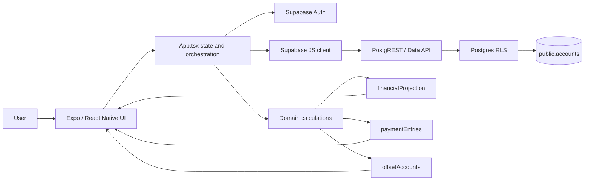
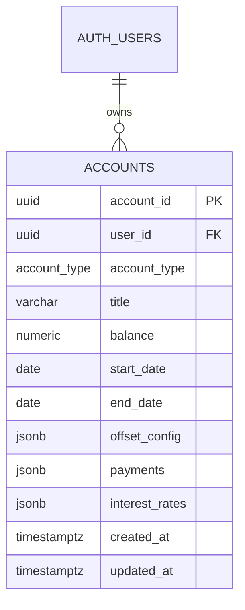

# UnDebt — Production technical design

**Branch:** `main` · **Baseline commit:** `60512dc` · **Status:** As implemented on production, not a target-state design.
**Audience:** Technical architects, designers, and developers.
**Proposed delta:** [Dev design](./dev.md). This production snapshot intentionally excludes dev-only multi-stage loan scheduling.

## 1. System overview

UnDebt is a client-rendered household finance planner. Expo/React Native screens collect account and cash-flow assumptions. TypeScript domain modules calculate current balances, forecasts, and summaries in the device/browser. Supabase provides email/password authentication, Postgres persistence, and row-level access control through its Data API. There is no application API server, scheduled backend worker, bank aggregator, or server-side projection engine.



### Runtime and component boundaries

| Layer | Responsibility | Main modules |
|---|---|---|
| Presentation | Navigation, forms, charts, responsive layout | `App.tsx`, `screens/`, `components/`, `theme/` |
| Orchestration | Auth session, selected tab, account collection, modal actions, Supabase reads/writes | `App.tsx`, `lib/supabase.ts` |
| Domain | Frequency expansion, account balance reconstruction, loan/asset projection, offset linking | `lib/paymentEntries.ts`, `lib/financialProjection.ts`, `lib/offsetAccounts.ts`, `lib/accountDisplay.ts` |
| Configuration | Account types, default rates/terms, financial-year rules | `config/accountTypes.ts`, `config.ts` |
| Platform services | Auth, Postgres, PostgREST, RLS | Supabase project; local CLI config at `supabase/config.toml` |

**Runtime versions:** Expo `~58.0.23`, React `19.3.0`, React Native `0.88.1`, TypeScript `~6.0.3`, Supabase JS `^2.119.0`, React Native Web `^0.21.4`. `expo-sqlite` is a dependency but is not used by the current application data path. `npm run web` starts Expo web; it does not build the static GitHub Pages app.

### Request and state flow

1. `supabase.auth.getSession()` initializes `user`; `onAuthStateChange()` tracks sign-in/out. `AuthScreen` uses Supabase email/password sign-up and sign-in.
2. When signed in, `fetchAccounts()` issues `.from('accounts').select('*').order('created_at', { ascending: false })`. The client does not add a `user_id` filter; RLS is expected to scope the result.
3. `App.tsx` stores the returned rows in React state, derives loan/transaction subsets, and memoizes summaries/projections. Domain calculation is local; it does not write forecast results.
4. Account create/update sends title, account type, balance, dates, `offset_config`, `payments`, and `interest_rates`. Activity actions replace the relevant JSONB array. Delete filters by `account_id`. Successful writes are followed by a refetch.
5. A new linked transfer is stored once on its source account and mirrored in calculations. Moving an existing activity between accounts performs two independent updates and attempts a compensating rollback if the second update fails; this edit is not an atomic database transaction.

## 2. UI and product surface

| Area | As-is capability |
|---|---|
| Overview | Total debt, assets, net worth, combined forecast |
| Loans | Loan table, create/edit/delete, balance forecast, scheduled/actual series, interest and repayment metrics |
| Accounts | Savings/checking/investment/transaction accounts, interest display, forecast, create/edit/delete |
| Loan management | Link cash/offset accounts to loans; set full, partial, or capped offset; add/edit/delete additional payments; show estimated savings |
| Save | Income and transfers-to-savings activities, period summary, comparison chart |
| Spend | Bill payments and expenses, available cash and projected remaining balance |
| Help & guides | In-app help |
| Settings/profile | Currency text field, financial-year start month, auth profile actions |

Account types: `HomeLoan`, `CreditCard`, `PersonalLoan`, `BuyNowPayLater`, `CarLoan`, `Savings`, `Checking`, `Investment`, `TransactionAccount`. The first five are loan types. Current currency display is `$`/AUD-oriented; the currency setting is not a general currency-conversion engine. Financial-year start defaults to July (zero-based month `6`).

## 3. Persistence model and schema

### Entity relationship



`expoapp/supabase/migrations/20261108135811_remote_schema.sql` is the authoritative migration. It creates a single application table; it does not create normalized transaction, repayment, or profile tables.

| Column | Definition / contract |
|---|---|
| `account_id` | UUID primary key, `gen_random_uuid()` default |
| `user_id` | UUID, `auth.uid()` default, FK to `auth.users(id)` |
| `account_type` | Required `public.account_type` enum |
| `title` | Nullable `varchar(255)` |
| `balance` | Required `numeric(15,2)`; no database default |
| `start_date` | Required `date`, defaults to `CURRENT_DATE` |
| `end_date` | Nullable `date` |
| `offset_config` | Nullable JSONB; default `{"percentage":null,"offset_type":"No Offset","linked_accounts":[]}` |
| `payments` | Nullable JSONB; default `[]` |
| `interest_rates` | Nullable JSONB; default `[]` |
| `created_at`, `updated_at` | Required `timestamptz`, default `now()` |

The enum `account_type` values are the nine account types above. Migration also creates `offset_type` with `Full Offset`, `Reduced Interest Rate`, `Capped Percentage Balance`, and `No Offset`; this enum is not the JSONB column type. Indexes: B-tree on account type and user ID; GIN on `payments` and `interest_rates`.

Core DDL shape (the checked-in migration additionally defines indexes, policies, grants, triggers, and the RLS event trigger):

```sql
create type public.account_type as enum (
  'HomeLoan', 'CreditCard', 'PersonalLoan', 'BuyNowPayLater', 'CarLoan',
  'Savings', 'Checking', 'Investment', 'TransactionAccount'
);

create type public.offset_type as enum (
  'Full Offset', 'Reduced Interest Rate', 'Capped Percentage Balance', 'No Offset'
);

create table public.accounts (
  account_id uuid primary key default gen_random_uuid(),
  user_id uuid not null default auth.uid() references auth.users(id),
  account_type public.account_type not null,
  title varchar(255),
  balance numeric(15,2) not null,
  start_date date not null default current_date,
  end_date date,
  offset_config jsonb default
    '{"percentage": null, "offset_type": "No Offset", "linked_accounts": []}'::jsonb,
  payments jsonb default '[]'::jsonb,
  interest_rates jsonb default '[]'::jsonb,
  created_at timestamptz not null default now(),
  updated_at timestamptz not null default now()
);

alter table public.accounts enable row level security;
create index idx_accounts_account_type on public.accounts (account_type);
create index idx_accounts_user_id on public.accounts (user_id);
create index idx_accounts_payments on public.accounts using gin (payments);
create index idx_accounts_interest_rates on public.accounts using gin (interest_rates);
```

### JSON contracts in application code

| JSONB column | As-is value |
|---|---|
| `payments` | Array of activity objects: `{id?, type, description?, amount?, startDate?, date?, frequency?, endDate?, linkedAccountId?, linked_account_id?}`. Activity types include `Income`, `Payment`, `Part Payment`, `Bill Payment`, and `Expense`. Production loan schedules use one `Principal and Interest` payment object. |
| `interest_rates` | Array of `{rate, date, endDate?}` entries; latest eligible start date supplies the loan rate. |
| `offset_config` | `{offset_type, percentage?, linked_accounts?, links_configured?}`. Links store loan IDs on the transaction/offset account; helper supports legacy inverse links stored on loans. |

JSON structure is validated in client code only; Postgres does not enforce the shape, enum-like JSON values, valid date ordering, or foreign keys between accounts referenced in JSON.

### RLS, triggers, and migration cautions

RLS is enabled on `public.accounts`. The migration creates a `FOR ALL TO PUBLIC` ownership policy (`auth.uid() = user_id`) plus separate authenticated SELECT/INSERT/UPDATE/DELETE policies with the same ownership predicate. These permissive policies overlap. Supabase `service_role` bypasses RLS; keep it off clients. The migration grants table operations to `anon` and `authenticated`, so RLS—not the grant—is the row boundary.

Two `BEFORE UPDATE` triggers (`trg_accounts_updated_at` and `update_accounts_updated_at`) call separate functions that both assign `updated_at = now()`. The DDL event trigger tries to enable RLS for newly created `public` tables; its exception handler logs failures rather than failing the DDL. Review these deployed behaviors before altering access or relying on automatic enforcement.

## 4. Database setup and query reference

The local Supabase CLI configuration sets Postgres major version 17, migrations enabled, seeds disabled, API schemas `public` and `graphql_public`, local DB port `54322`, and Auth email signup enabled. Docker is needed for local Supabase services.

```sh
cd expoapp
npm ci
npx supabase start
npx supabase db reset       # local only: recreate DB and replay migrations
npx supabase status
npx expo start --web
```

The app's `SUPABASE_CONFIG` in `expoapp/config.ts` currently contains the hosted project URL and client publishable key; it does not automatically consume local CLI credentials or separate development/production environments. To test against local Supabase, use the local API URL and anon/publishable key reported by `npx supabase status` in a local-only config. The publishable/anon key is a client identifier, not an authorization boundary; never put the `service_role` key in the app.

For a remote project, authenticate and link it first; inspect migration state before applying anything:

```sh
npx supabase login
npx supabase link --project-ref <project-ref>
npx supabase migration list
npx supabase db push        # applies pending migrations to the linked remote
```

Do not run `db push` against production without confirming the linked project, pending migration list, backup/rollback plan, and review. GitHub Pages does not run Supabase migrations. The migration file—not a hand-copied schema fragment—is the source of truth.

**SQL equivalents** for app operations (execute with an authenticated JWT so `auth.uid()` is populated; an administrative SQL editor can bypass RLS):

```sql
-- Read: the application relies on RLS; this predicate is shown explicitly for clarity.
select *
from public.accounts
where user_id = auth.uid()
order by created_at desc;

-- Create an account. Parameters are supplied by the authenticated client.
insert into public.accounts
  (user_id, account_type, title, balance, start_date, end_date, payments, interest_rates)
values
  (auth.uid(), $1::public.account_type, $2, $3::numeric(15,2),
   $4::date, $5::date, $6::jsonb, $7::jsonb);

-- Update account fields or replace an activity array; App.tsx filters by account_id.
update public.accounts
set payments = $2::jsonb
where account_id = $1::uuid
  and user_id = auth.uid();

delete from public.accounts
where account_id = $1::uuid
  and user_id = auth.uid();
```

**Useful schema/policy inspection:**

```sql
select column_name, data_type, is_nullable, column_default
from information_schema.columns
where table_schema = 'public' and table_name = 'accounts'
order by ordinal_position;

select policyname, roles, cmd, qual, with_check
from pg_policies
where schemaname = 'public' and tablename = 'accounts';

select tgname, pg_get_triggerdef(oid)
from pg_trigger
where tgrelid = 'public.accounts'::regclass and not tgisinternal;
```

## 5. Calculation behavior

All projections are client-side estimates. They should not be represented as lender quotes, reconciled actual transactions, or financial advice.

### Activity recurrence and current balances

- Dates are ISO `YYYY-MM-DD`. A missing frequency represents a one-off entry; recognized recurring frequencies include daily, weekly, fortnightly, monthly, quarterly, half-yearly, and yearly.
- Day-based occurrence counting uses fixed day intervals. Month-based counting anchors occurrence number to the original start date and clamps that original day to each target month’s last day. Recurring end dates are inclusive; a no-repeat entry counts once on its start date. Unknown non-empty frequencies fall back to monthly in activity counting; a literal `One-time` frequency is one-off in forecast-event generation but falls through to monthly in activity counting.
- For recurring activity, `N(a; s,e) = max(0, C(e) − C(s−1 day))`, where `C(d)` counts anchored occurrences from entry start through `min(d, endDate)`; daily/weekly recurrence uses integer day intervals, and monthly recurrence uses the anchored month index with month-end clamping. For a no-repeat entry, `N=1` only when its start date falls inside the window.
- `getAccountBalancesAsOf()` starts from the saved `balance`; for each accepted activity it adds/subtracts `amount × occurrenceCount` from `max(start_date || created_at-date, activity-start-date)` through the requested date. `Income` adds; `Payment` debits its source and credits its linked account; `Part Payment` debits its source and loan; ordinary spending debits a transaction account but increases a credit-card/BNPL liability. Other account/activity combinations are not specially reconciled.
- **Balance meaning is underspecified:** there is no `balance_as_of`/opening-balance field. The algorithm adds all eligible historical activities to the persisted balance. If users enter a current statement balance, the same past recurring entries can be counted again; the UI has no way to detect or correct that.
- Invalid date inputs to public summary/projection calls throw. Malformed JSON in some projection parsers is instead treated as absent and may fall back to defaults.

### Loan and account forecasts

For a loan period with annual rate `r`, frequency periods `N`, interval duration `dt`, and scheduled interval duration `T`, the period rate is approximately:

```text
periodRate = Σ ((annualRate_i / 100 / N) × (segmentDuration_i / T))
```

where each \(i\) is a dated rate segment. Then:

```text
interest = max(0, loanBalance - offsetBalance) × periodRate + chargeInterest
```

where \(B\) is loan balance and \(O\) is linked offset balance (capped to the loan balance). The production simulator uses one saved scheduled repayment per loan at the configured frequency, adds interest/charges, applies the scheduled amount, then applies linked additional payments. Rate segments are prorated within the scheduled interval; the model is not daily compounding.

Transaction-account interest uses anniversary windows. For each cursor-to-12-month-anniversary window, each rate segment `i` contributes `r_i / 100 × segmentDuration_i / fullWindowDuration` to a simple-interest factor; a partial final window still uses the full anniversary-window duration as denominator. The window adds `max(0, balance) × (factor − 1)`. It is not daily compounding. Cash-flow events split these windows and restart a new anniversary window at each event. Only positive balances earn interest. A linked offset account is not separately interest-grown in the forecast.

For each linked cash account, offset funds are allocated among its linked loans in proportion to their positive starting balances. Partial offset first multiplies cash by the configured percentage; capped offset uses full cash but caps each loan's allocation to the configured share of that loan's starting balance. Aggregate offset is capped at the loan's starting balance, and the simulator then applies `max(0, currentSimulatedLoanBalance − offset)`. This is a simplified allocation model: proportions and caps are not recomputed from each loan's declining simulated balance.

The horizon is at most 30 years. Annual chart samples are taken at yearly intervals. The default horizon uses the latest modeled finish date of non-credit-card loans (actual payoff if paid off, otherwise the loan's maturity/horizon); credit cards alone use the 30-year horizon. Additional-payment timing is based on generated recurrence events.

### Summary formulas

- `net worth = total assets − total debt`.
- Scheduled monthly repayment summary = sum of `configured amount × periods per year ÷ 12`, with annual period multipliers of 365/52/26/12/4/2/1 for daily/weekly/fortnightly/monthly/quarterly/half-yearly/annual. It is a run-rate, not the cash due in the selected horizon.
- Loan-screen interest saved = `max(0, scheduled interest − actual interest)`, where actual includes both offsets and additional payments. The separate `offsetInterestSavedByYear` projection compares scheduled against offset-only runs and is not the value displayed by the current loan summary.
- Spend: `available = starting available transaction balances + all Income occurrences`; `spend = Bill Payment + Expense occurrences`; `cash after spending = available − spend`. Linked savings transfers (`Payment`) are counted in a separate flow total but are **not deducted** from this displayed available/cash-after-spending calculation.
- Save: income and saved amounts are each the sum of their occurrences inside the chosen period. Save's “Cash at period end” is currently wired to Spend's `projectedAvailable` (starting cash plus income): it does not subtract the displayed saved transfers or expenses and does not include projected account interest. “Cash at period start” is separately calculated through the transaction forecast, so the two cards do not form a consistent opening/closing ledger.
- Activity period windows are one to twelve months (`asOf + 1 day` through `addMonths(asOf, n)`, inclusive) or an entire selected financial year (start date through the day before the next start). Financial-year windows are not clipped to today. July is the default year start.
- Default example rates are constants, not live rate feeds: baseline 4.85%; home margin +2.10%, car +2.05%, personal +3.65%, credit card +15.55%, BNPL −4.85%; savings/checking subtract 2.50%. User/account rates may differ.

### Numeric UI inventory and data lineage

The UI formats values; it does not recalculate them. Currency strings use `$` regardless of the editable currency label in Settings. Most metric/chart formatters show up to two decimals; account/loan table balances use their own number formatting. Displayed activity amounts are the entered per-occurrence amount, while metrics aggregate occurrences.

| Screen / component | Every numeric value shown and its source |
|---|---|
| **Overview — metric cards** | `Loan balances` = sum of App's projected loan starting balances; `Cash and assets` = sum of projected transaction starting balances; `Net worth` = assets − debt. With a projection-length selection these start at today; with a selected FY they start at FY start, despite “Current total” labels. |
| **Overview — combined chart** | Annual samples of each loan simulation and transaction-account forecast; total-loan and total-assets lines are sums of their account series at each year sample. It is not a net-worth series. |
| **Loans — summary** | `Loan balances today` = App's starting debt total (FY-start debt in FY mode); “active loans” count is actually all loan rows (no maturity/positive-balance filter). Scheduled/extra monthly values use the run-rate formulas above. Balance and interest values are cumulative-simulation samples at `years`; interest saved compares scheduled and actual (offsets + extra payments). |
| **Loans — chart and table** | Chart plots per-loan actual and scheduled annual balance samples, joined by straight line segments; each sample is the last event balance at or before `projectionStart + N calendar months`. Table balance is `currentBalances` (as-of today), separate from FY-start summary; rate is the first stored rate entry; payment and frequency are read from `payments[0]`; end date is the account's stored end date. No row value solves an amortization amount. |
| **Accounts — metric cards** | Total account balance = sum of as-of-today transaction account balances. Start/end “interest-earning balance” = positive balances for accounts that are not linked to any existing loan; start/end “offset balance” = all positive cash in linked accounts, not the effective partial/capped offset. Projected account balance = sum of account forecast values at selected `years`; growth = that amount minus today's total, even in FY mode. |
| **Accounts — table/chart** | Row balance = reconstructed as-of balance; displayed rate = first stored rate entry (not the rate active today). Chart plots account forecasts and a selected-account-total series; the “total” is a sum of the currently selected individual account series. |
| **Loan management — cards** | Period-start cash = sum of transaction-account projections at `projectionStartDate`; start/end offset amounts = full positive balances of linked accounts. Additional loan payments = all `Part Payment` occurrences stored on transaction accounts in the date window; it does not require a valid linked-loan ID. Interest saved = scheduled minus actual interest at the selected annual sample, floored at zero. |
| **Loan management — lists/forms** | Payment row amount is its entered per-occurrence amount (the list is not period-filtered); offset row balance is the account's as-of balance; offset percentage is configured input (Partial scales cash; Capped limits allocated loan balance). Loan balances in the link editor use `currentBalances`. These are inputs/configuration, not derived savings. |
| **Save — cards/chart/list** | Period income and savings are occurrence totals for `Income` and linked-transfer `Payment` entries. The chart bar lengths are each total divided by `max(income, saved)`. Cash at period start is a separate transaction forecast at `periodStart`; “Cash at period end” is Spend `projectedAvailable`, not a ledger closing balance (see formula above). Entry amounts are raw per-occurrence amounts; section record counts count JSON entries, not occurrences. |
| **Spend — cards/chart/list** | Available = starting transaction balances + Income occurrences; bill/spend totals aggregate `Bill Payment` and `Expense` occurrences; after spending = available − those totals. Chart bars are each value / `max(0, available, bills, expenses)` with negative bar widths clamped to zero. The list shows all matching records, not only records in the chosen period; row amounts are per occurrence. Part payments are returned separately and do not enter Spend totals. |
| **Sidebar / pickers / shared components** | Sidebar badges are raw loan/account counts (shown only when > 0), regardless of payoff/end-date; Help's 01–05 and schedule labels are static/order numbers. Loan projection picker is 1–30 years; automatic years = ceiling of estimated final non-credit-loan modeled finish duration, clamped to 1–30 (30 if no non-credit loans); an unpaid loan reaching maturity still counts as reaching its modeled finish. FY mode exposes prior/current/next FY. Save/Spend picker is 1–12 months or an FY. `MetricCard` only renders provided strings. |
| **Settings / Help / profile / date picker** | Financial-year month is a zero-based month index that changes period boundaries. Currency is editable text only and has no calculation/formatting effect. Help numbers are static guide numbering; calendar day/year numbers are date selection. Profile shows no calculated financial number. |

`LoanProjectionSummary` renders (without further computation): scheduled tile = scheduled-only balance/interest plus scheduled monthly run-rate; “With extra payments” tile = actual balance/interest plus scheduled and upcoming-extra monthly run-rates; saved tile = floored difference between scheduled and actual cumulative interest. The chart y-axis uses the maximum visible series value through the selected year, rounds it up to a 1/2/3/…×power-of-ten bound, and labels 0%, 50%, and 100% of that bound as rounded whole dollars. Lines connect annual samples; they do not represent event-level or monthly interpolation.

#### Account-form presets (not computed live)

Presets are applied when the account type is selected in the form. `4.85%` is a hard-coded illustrative base, not an RBA lookup. Preset APR arithmetic is base plus/minus the configured margin.

| Account type | Default balance | Default rate | Default scheduled amount / cadence | Default term |
|---|---:|---:|---|---|
| Home loan | $750,000 | 6.95% | blank / monthly | 30 years |
| Car loan | $28,000 | 6.90% | blank / monthly | 5 years |
| Personal loan | $12,000 | 8.50% | $350 / monthly | 5 years |
| Credit card | $2,500 | 20.40% | $150 / monthly | no preset maturity |
| Buy Now Pay Later | $400 | 0.00% | $100 / fortnightly | 6 months |
| Savings | $5,000 | 2.35% | none | none |
| Checking | $1,500 | 2.35% | none | none |
| Investment / Transaction account | blank | blank | none | none |

The account form's balance/rate/payment fields are direct user inputs. Settings' currency is local component state and does not alter symbols, units, formatting, or calculations. Financial-year month is also client state; changing it changes period boundaries and projection start dates.

### Calculation assumptions and omissions that affect displayed numbers

These are observed implementation behavior, not recommendations:

1. **Historical balance baseline:** stored balance is treated as an opening figure plus activities through `asOf`; no balance-as-of date or reconciliation exists. Historical schedules can double-count if the stored number is already current.
2. **Recurrence implementations differ:** activity occurrence counting anchors each month to the original date (e.g. Jan 30 → Feb 28 → Mar 30); forecast event generation advances sequentially with month-end preservation (Jan 30 → Feb 28 → Mar 31). Later-month event totals/dates can disagree.
3. **Rate dates:** rate selection uses the latest `date` not after the segment; `endDate` is stored/displayed but does not deactivate a rate. Before the first dated rate, projection rate is 0 when a rate array exists. The table displays the first array item, not the selected date's active rate.
4. **Loan timing:** production reads the first `payments` item as the scheduled payment and cadence; it ignores that entry's `startDate` and begins the next payment one configured frequency after the projection cursor (today or FY start), then repeats from the cursor. It accrues a frequency-period rate `annualRate / periodsPerYear`, weighted by elapsed milliseconds in that scheduled period. It adds interest/charges, then fixed scheduled payment, then additional payment. A payment `endDate` gates due dates but a rate `endDate` does not gate rates. It is simple prorating, not lender day-count, daily accrual, or intra-period compounding. Extra payments made within an interval reduce principal only at the interval end.
5. **Offset timing/allocation:** offset balance is sampled at the interval end and applied to the entire interval, not time-weighted; future offset cash flows do not earn deposit interest. Allocation weights and caps use loan input/start balances, not each declining simulated balance.
6. **Projection date/index mismatch:** chart samples use calendar `addMonths(start, years × 12)`. Non-FY `projectionEndDate` for the offset screen is start plus `years × 365.2425` days. In FY mode, selected-year end is the last FY day, while the annual loan/asset sample at index 1 is FY-start + 12 calendar months (the next FY start). These related cards can therefore use different cutoffs.
7. **Comparisons are not full cash ledgers:** transfers are omitted from Spend's available calculation; Save's end-cash card reuses that available figure; no taxes, fees except entered card/BNPL expenses, inflation, cash constraints, transaction reconciliation, currency conversion, or future account-fee model is included.
8. **Input/display gaps:** account rate display uses the first stored rate, loan table uses the first payment JSON object, and amount formatters always use `$`. Negative transaction balances are accepted in historical totals, but annual transaction-series projection clamps the initial balance to zero; loan simulation also clamps starting debt to zero while some total-debt cards sum the signed balance. Account balance semantics and negative-balance behavior are not consistent across the date-query, summary, and chart paths.

For exact call sites, see [App.tsx](../expoapp/App.tsx), [paymentEntries.ts](../expoapp/lib/paymentEntries.ts), [financialProjection.ts](../expoapp/lib/financialProjection.ts), [accountDisplay.ts](../expoapp/lib/accountDisplay.ts), [LoanProjectionSummary.tsx](../expoapp/components/common/LoanProjectionSummary.tsx), [TransactionsScreen.tsx](../expoapp/screens/TransactionsScreen.tsx), [OffsetScreen.tsx](../expoapp/screens/OffsetScreen.tsx), [SaveScreen.tsx](../expoapp/screens/SaveScreen.tsx), and [SpendScreen.tsx](../expoapp/screens/SpendScreen.tsx).

## 6. Gaps and delivery

**Product/technical gaps:** JSONB lacks relational constraints/history; account setting state is not a durable preferences model; no bank import, multi-currency conversion, budget engine, export/restore, offline sync, or test suite is present. There is no stage-specific Supabase configuration; `config.ts` points to one hosted project. Cross-account writes are not atomic. No CI job currently runs a full app build or financial regression suite.

**Schema/design risks:** Offset values differ between the unused database enum and strings used in JSON/app logic (`Reduced Interest Rate` vs `Partial Offset`, `Capped Percentage Balance` vs `Capped Offset`). Rate selection uses rate start dates; stored `endDate` values do not independently deactivate rates. Redundant RLS policies and update triggers need cleanup through reviewed migrations. Validate legacy JSON, timezone boundaries, rate assumptions, and projection outputs with golden test cases before materially changing calculations.

**Release model:**

1. `main` is production; `dev` is the proposal/integration branch. Keep the two design sets separate.
2. Every material app change on `dev` must update `docs/dev.md` and `docs/dev.html`; the Pages workflow checks for both. The current dev proposal is in [the dev technical design](./dev.md).
3. A `dev` → `main` PR must update `docs/production.md` and `docs/production.html` to describe the exact release. The workflow checks this when application files change in the PR.
4. Review calculations, RLS and migrations, visual/accessibility behavior, and both doc sets. Type-check with `cd expoapp && npx tsc --noEmit`; run focused tests/builds when present. Merge only approved changes; the merge makes the refreshed production doc and code the new main baseline.
5. GitHub Pages publishes the static `docs/` site from `dev/docs` at [UnDebt design docs](https://vignesh-karthick-uthaya-kumar.github.io/UnDebt/). At this revision the repository Pages source is configured to branch `dev`, path `/docs`; the GitHub Actions workflow also validates documentation and publishes on dev pushes. Expo app delivery and Supabase migrations have separate procedures.

**Code references:** [App.tsx](../expoapp/App.tsx) · [financialProjection.ts](../expoapp/lib/financialProjection.ts) · [paymentEntries.ts](../expoapp/lib/paymentEntries.ts) · [offsetAccounts.ts](../expoapp/lib/offsetAccounts.ts) · [schema migration](../expoapp/supabase/migrations/20261108135811_remote_schema.sql) · [Supabase CLI config](../expoapp/supabase/config.toml).
